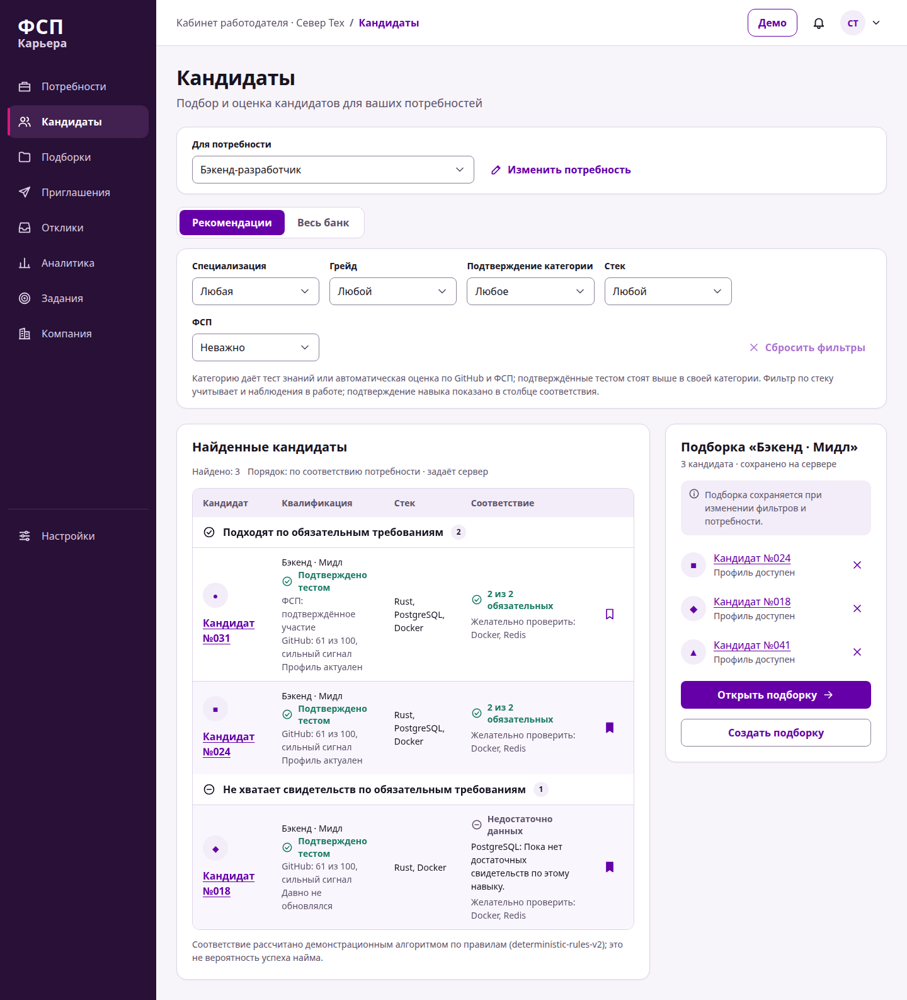
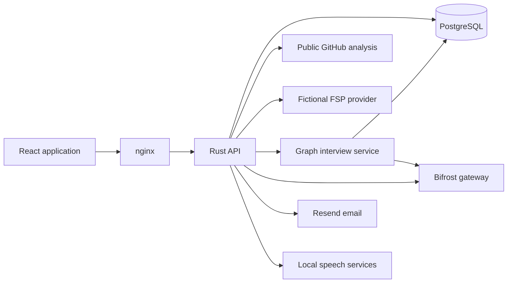

<!-- nddev-public-hackathon -->
# hack-2026-lct-fsp

LCT 2026 FSP hackathon: Career reverse-hiring platform with assessments, anonymous profiles and employer offers. Rust + React.

[NDDev OpenNetwork](https://github.com/NDDev-Technocracy-OpenNetwork) · [Repository](https://github.com/NDDev-Technocracy-OpenNetwork/hack-2026-lct-fsp)

This repository is a hackathon prototype or supporting tool. Follow the project-specific setup below; cloud integrations require your own configuration and credentials.

---

# FSP / Career

**Reverse hiring built around skills, evidence and candidate consent.**

FSP / Career connects developers with employers through anonymous profiles, knowledge assessments and
explainable vacancy matching. Employers describe the work and approach suitable candidates with a salary
range. Candidates decide which company can receive their contact details.

Built for the FSP 2026 special track. The application interface is in Russian.

[Live demo](https://nddev.link) · [Demo walkthrough](frontend/docs/DEMO_SCRIPT_RU.md) ·
[Screens](frontend/docs/SCREENS.md) · [API contract](contracts/README.md) · [Contributing](CONTRIBUTING.md)

## What the platform does

| For candidates | For employers |
| --- | --- |
| Build a profile from a questionnaire, a digital PDF, public GitHub work and FSP records | Describe a role, its technology stack, required skills and qualification level |
| See the source and confidence of an estimated category separately from a test-confirmed grade | Search anonymous profiles, compare evidence against requirements and maintain shortlists |
| Take versioned knowledge tests and a graph-guided interview with optional voice input | Review GitHub/FSP summaries and contextual recommendations within the company's access rights |
| Explore vacancies with explanations of strengths and missing evidence | Publish vacancies, review applications and send invitations with a salary range |
| Accept invitations or apply while choosing which contacts to disclose | Receive the contacts the candidate chose to share with that company |
| Complete short company tasks and keep the profile's activity signal current | Publish tasks and review candidate responses |

Matching uses deterministic rules shared by both workspaces. It distinguishes confirmed requirements from
observations in source data, explains gaps and ranks results before pagination. Knowledge-test scoring is
deterministic too: model-generated advice and source estimates cannot grant a verified grade.

<details>
<summary>Employer workspace: candidate search and matching</summary>



Screenshot from the development demo with fictional data. More views are in the [screen guide](frontend/docs/SCREENS.md).

</details>

## Try the demo

Open **[nddev.link](https://nddev.link)**. The sign-in screen discloses these fictional accounts:

| Role | Email | Verification code |
| --- | --- | --- |
| Candidate | `alexey@example.com` | `123456` |
| Employer: Sever Tech | `hr@sever-tech.example` | `123456` |
| Second employer | `hr@second-company.example` | `123456` |

Other addresses on the public stand receive a real, single-use email code. The fixed code applies only to the
three disclosed seed addresses there; local demo mode uses it for all addresses. For a guided presentation,
follow the [Russian demo walkthrough](frontend/docs/DEMO_SCRIPT_RU.md).

## Architecture



- **Frontend:** React, strict TypeScript 7, Vite and TanStack Router/Query/Form, organized with Feature-Sliced
  Design. API types come from the shared OpenAPI contract.
- **Backend:** Rust/axum with domain and application layers, adapter ports and PostgreSQL persistence through
  SQLx. The API enforces roles, company boundaries, consent, idempotency and disclosure.
- **Integrations:** a separate service analyzes public GitHub work; a fictional FSP provider supplies demo
  competition evidence. Bifrost provides profile reviews, PDF field extraction and interview feedback.
  Optional local speech uses Silero for synthesis and GigaAM for transcription.
- **Operations:** nginx and systemd on the stand; Docker Compose for local use and integration checks.
  OpenObserve and Vector collect scoped diagnostics, operational audit, browser performance and masked replay.

The stateful HTTP mock implements the same contract for frontend development. It is a separate development
service; the public application uses Rust and PostgreSQL.

## Quick start with Docker

Prerequisites: Git, Docker Engine or Docker Desktop, and the Compose plugin. Container builds supply the
application toolchains; no local Rust, Bun or provider credentials are needed for the base demo.

```sh
git clone https://github.com/NDDev-Technocracy-OpenNetwork/hack-2026-lct-fsp.git
cd hack-2026-lct-fsp
docker compose up --build --detach --wait
```

Open **http://localhost:8080** and use a demo account above, or register a new local account with code `123456`.
Compose starts PostgreSQL, the API, frontend, FSP simulator and interview service. Without Bifrost, interviews
use the explicit offline rubric. GitHub analysis, PDF import, neural speech and observability require additional
configuration; see the [backend guide](backend/README.md) and [operations guide](infra/README.md).

```sh
docker compose ps              # container readiness
docker compose logs -f api     # application logs
docker compose down           # stop; keep PostgreSQL data
```

The application binds to `127.0.0.1:8080`; PostgreSQL's development port is `127.0.0.1:5434`. Set `FSP_PORT` or
`FSP_DB_PORT` to change them. The `pg-data` volume survives ordinary `down`; adding `--volumes` removes local
database data. Optional settings are documented in [`.env.example`](.env.example); a populated `.env` stays
outside Git. Demo defaults are intended for local development.

## Local development

Run commands from the repository root. Use `just` to list the available tasks.

| Tool | Version / use |
| --- | --- |
| Bun | 1.4.2; locked TypeScript dependencies and development tools |
| Node.js | 26 in CI; 24.15 or newer for Vitest, which runs on Node rather than Bun |
| Rust | 1.99.0 with rustfmt and clippy, pinned in [`backend/rust-toolchain.toml`](backend/rust-toolchain.toml) |
| Docker Compose | Local PostgreSQL and container integration |
| just | Root task runner; recipes in [`justfile`](justfile) |

### Frontend with the development mock

```sh
just install
just mock                     # terminal 1: http://127.0.0.1:4010
```

In a second terminal:

```sh
just dev                      # http://127.0.0.1:5173
```

The mock includes demo actor switching, a mailbox and scenario controls. These controls are excluded from
production bundles. Exact dependencies, scripts and build flags are in the [frontend guide](frontend/README.md).

### Frontend with the Rust API

After `just install`, start PostgreSQL and run the following long-lived processes in separate terminals:

```sh
just db-up
just fsp-simulator            # terminal 1: fictional provider on 127.0.0.1:4020
```

```sh
just backend                  # terminal 2: Rust API on 127.0.0.1:8080
```

```sh
FSP_API_TARGET=http://127.0.0.1:8080 just dev   # terminal 3: frontend on 127.0.0.1:5173
```

The API applies embedded migrations and initializes the synthetic seed. Start additional services with
`just github-insights` or `just interview`, then set their API URLs and, for interviews, the shared internal
token as described in the [backend configuration](backend/README.md#run-and-check). Local API authentication
defaults to demo mode. The frontend's mock-only controls are unavailable against the Rust API.

## Checks

| Command | Coverage |
| --- | --- |
| `just verify` | Contract drift, TypeScript, lint, mock/component tests, frontend build and production bundle checks |
| `just backend-check` | Rust formatting, clippy and workspace tests, including PostgreSQL HTTP/storage regressions |
| `just e2e` | Playwright browser acceptance against the mock |
| `just contract` | Regenerate OpenAPI, shared API types and the operation index after a contract change |

Start PostgreSQL with `just db-up` before backend checks. On a new machine, install Playwright's Chromium
runtime with `cd frontend && bunx playwright install --with-deps chromium`. Backend tests create isolated
databases through `FSP_TEST_DATABASE_URL`; see the [backend guide](backend/README.md#run-and-check).
The [frontend testing guide](frontend/docs/TESTING.md) covers browser prerequisites and public acceptance.

## Repository and documentation

| Path | Purpose |
| --- | --- |
| [`frontend/`](frontend/README.md) | Web application, design system, screens and browser tests |
| [`backend/`](backend/README.md) | Rust workspace, migrations and integration adapters |
| [`contracts/`](contracts/README.md) | OpenAPI contract, error catalog, operation index and TypeScript generator |
| [`mock-server/`](mock-server/README.md) | Stateful development API and contract behavior reference |
| [`infra/`](infra/README.md) | Provisioning, releases, nginx and service configuration |
| [`docs/product/`](docs/product/BUSINESS_RULES.md) | Business rules, requirements traceability and organizer specification |

Feature guides: [knowledge tests](docs/knowledge-tests.md), [GitHub insights](docs/github-insights.md),
[automatic profiles](docs/auto-profile.md), [graph interviews](docs/interview-service.md) and the
[FSP simulator](docs/fsp-simulator.md). Operations: [private CI](infra/ci/README.md),
[observability](infra/observability/README.md) and [current behavior and limits](docs/current-state.md).

## Scope and limitations

FSP competition data and seed accounts are explicitly fictional. GitHub analysis uses public evidence and
does not certify professional experience. Knowledge tests and interview feedback are not calibrated hiring
scores; source estimates remain distinct from test-confirmed grades. PDF import supports digital text, not OCR.

The stand is a single-server deployment. Background analysis queues and profile-review tasks are process-local;
search ranks candidate collections in memory. Large-scale capacity and high availability have not been established.
Optional providers can fail, and configuration flags do not prove provider health. These boundaries are detailed
in [current system state](docs/current-state.md).

## Contributing

Follow [CONTRIBUTING.md](CONTRIBUTING.md) for ownership, contract changes and required checks. Feature branches
merge into `danil` or `dima`, then `dev`, then `main`; deployment uses `main`. The private CI workflow and its
current recovery status are documented in the [CI runbook](infra/ci/README.md).

The former Python/FastAPI MVP is preserved at tag `archive/dima-mvp`; it is not part of the current application.

<!-- nddev-upstream-freeze -->

## Competition submission and maintenance

The FSP/LCT 2026 submission deadline was **2026-10-11 at 23:59 Moscow time (UTC+03:00)**, as specified by the owner. The shared upstream is frozen for submission changes. This NDDev OpenNetwork repository is a public showcase and post-event maintenance copy; changes here do not alter the upstream submission.

