# Screens

Every route of the application as implemented. Screenshots in [`screenshots/`](screenshots) were refreshed on
2026-10-08 against the development mock (`SCREENSHOTS=1 bun run e2e e2e/screenshots.spec.ts`). They illustrate
fixture data, including the current knowledge-test workspace; live email evidence is in [TESTING.md](TESTING.md). Operations per
route are listed in [`../../contracts/API_INTEGRATION.md`](../../contracts/API_INTEGRATION.md#screens-and-operations);
the rules behind each state are in [`../../docs/product/BUSINESS_RULES.md`](../../docs/product/BUSINESS_RULES.md).

Both workspaces share one shell: a sidebar with the role's sections and «Настройки», a header with breadcrumbs
(«Кабинет кандидата» or «Кабинет работодателя · company», then the section), the «Демо» button while the API runs in
mock mode, a bell with the count of new invitations (candidate) or new applications (employer), and the account
menu. Below 1024 px
the sidebar becomes a drawer opened from the header.

## Sign-in

### `/login` — «Вход и регистрация»

- Choose «Кандидат» or «Работодатель», enter an e-mail, «Получить код». A new address creates an account of that
  role; an address registered with the other role gets «Роль аккаунта изменить нельзя».
- Second step «Подтвердите почту»: six-digit code with its lifetime, «Подтвердить и войти», «Отправить новый код»,
  «Изменить почту». Wrong, expired, used and locked codes each get their own message and the resend button is
  highlighted.
- On nddev.link, Resend sends the code to the supplied mailbox. The page explains inbox/spam checks and resend
  timing; no code or seed-account shortcut is displayed. Local demo delivery explains that no mail is sent;
  development offers «Вставить код из демо-ящика». Fixed-code/seed hints require `realEmail` to be false.
- After a `401` elsewhere the page shows «Сессия завершилась»; an already signed-in visitor sees «Вы уже вошли» with
  «Перейти в кабинет» and «Выйти».

## Candidate

Navigation: Обзор, Профиль, Источники, Навыки, Проверки, Задания, Приглашения, Вакансии, Отклики, Настройки.

### `/candidate/onboarding` — «Анкета кандидата»

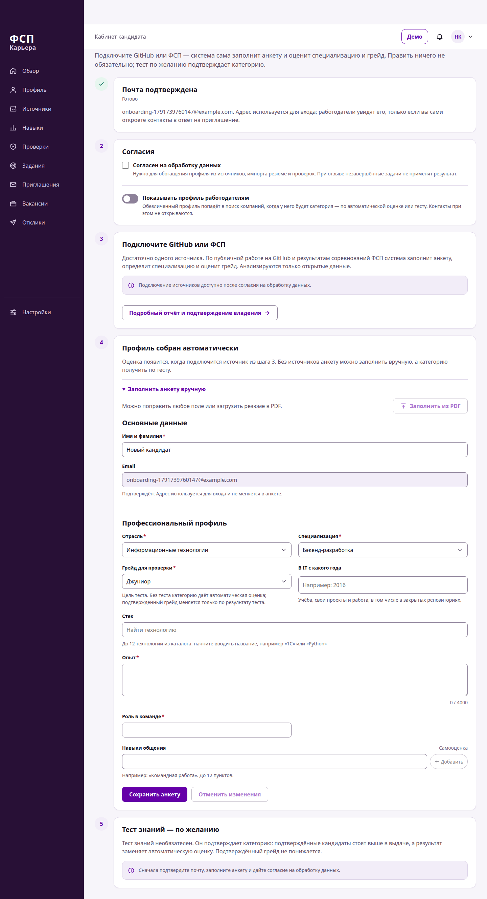
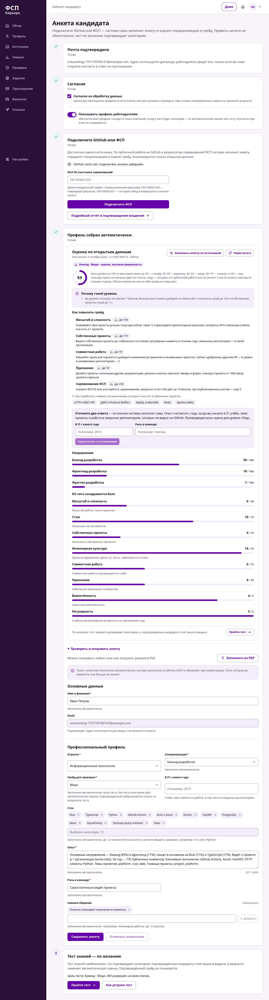

Five steps with done markers: e-mail confirmed; consents (processing and publication as separate controls);
«Подключите GitHub или ФСП» — GitHub by login or profile link with the running analysis stage, and the FSP ID, both
after processing consent, plus «Подробный отчёт и подтверждение владения»; «Профиль собран автоматически» — the
estimate card (category with its source and confidence, score, «Почему такой уровень» with the notes on caps,
tenure from the questionnaire and what the next grade needs, «Как повысить грейд» — the steps with their points,
«С чем поработать» skills and «Советы ИИ» — «Уточните два ответа» («В IT с какого года» with the resulting years, role
in the team, «Пересчитать с уточнениями»), directions, factors, the LLM's second opinion — «ИИ готовит второе мнение об
оценке…» while the background review runs, «Обновляем анализ GitHub…» while an outdated report is re-analyzed —
one-click «Заполнить анкету по источникам», «Пересчитать» and «По желанию: … Пройти тест») and the questionnaire under «Проверить и поправить анкету» («Заполнить анкету
вручную» while it is incomplete, open until the candidate closes it), where automatic answers are marked «Заполнено
автоматически» and «Заполнить из PDF» is available; «Тест знаний — по желанию» with «Пройти тест» for the saved target
when the server allows it, otherwise the reason (unsupported specialization, active attempt, cooldown, downgrade).
Without a source the estimate step says the questionnaire can be filled by hand and the category earned by a test.

### `/candidate/overview` — «Мой профиль»

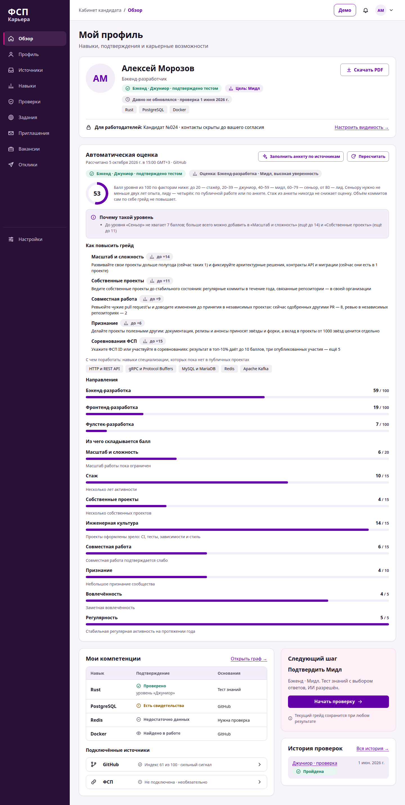

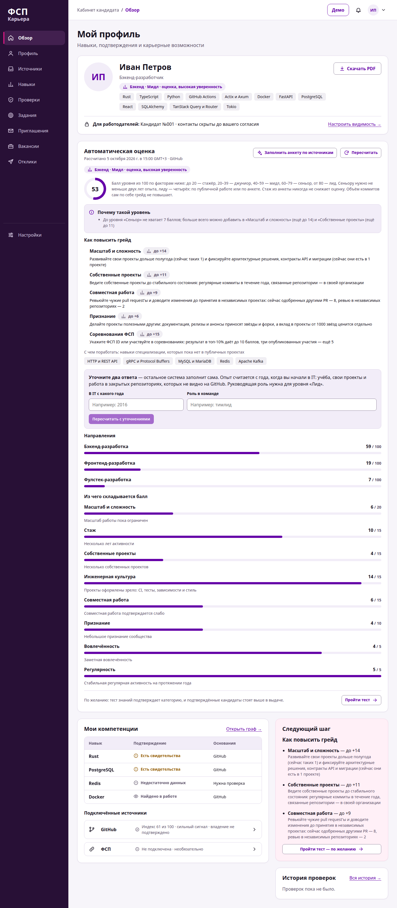

- Identity card: name, role, the category badge with its source («Бэкенд · Джуниор · подтверждено тестом», «Бэкенд ·
  Мидл · оценка, высокая уверенность» or «Категория не присвоена»); the role follows the category's specialization, target badge («Цель: Мидл») when it differs from
  the category grade, profile freshness once a grade is verified, stack, «Скачать PDF», and the visibility line: the
  alias employers see, or the blockers that keep the profile out of search.
- «Соберите профиль» while the questionnaire is incomplete.
- «Автоматическая оценка»: the estimate card, or «Подключите GitHub или ФСП» / «Оценить профиль» without an estimate.
- «Мои компетенции»: skills with state, confirmed level and evidence sources, plus a summary of GitHub (the running
  analysis stage, then the index, band and ownership state) and FSP.
- «Следующий шаг» (shared with «Проверки»): continue the questionnaire, continue an active attempt, open an
  evaluating one; with an estimated category «Как повысить грейд» — the top three growth steps — and «Пройти тест — по
  желанию»; otherwise start a check for the target, or the reason why not, with the date the cooldown ends.
- «История проверок»: the last three attempts.

### `/candidate/profile` — «Профиль и цели»

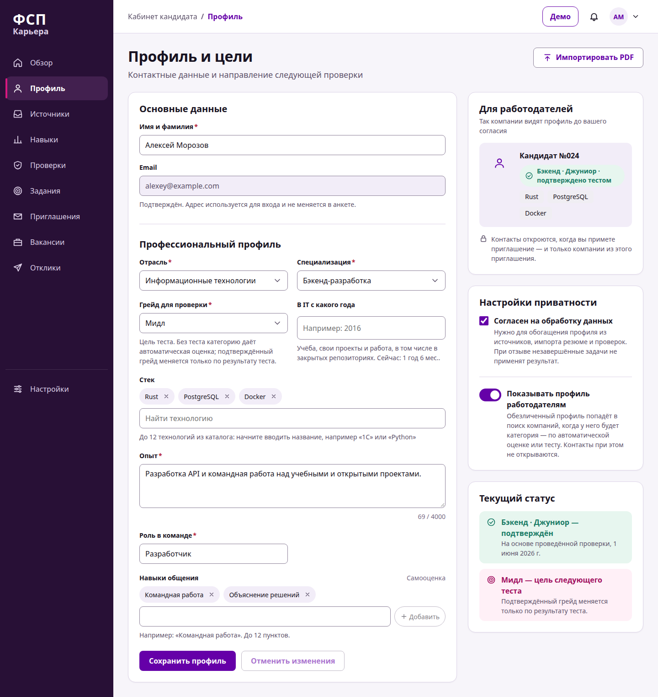

The profile form (name, read-only e-mail, industry, specialization grouped by direction, grade for the check,
«В IT с какого года» (study, own projects and work; the hint shows the resulting years or the months stated earlier),
a searchable stack of up to 12 catalog technologies,
experience, team role, soft skills) with «Сохранить профиль» and «Отменить изменения»; «Импортировать
PDF»; «Для работодателей» — the anonymous preview with the category badge; privacy settings; «Текущий статус» with the
verified grade, or the estimated category, or «Категории пока нет», and the target of the next test shown separately.
Automatic answers, soft skills included, are marked «Заполнено автоматически»; changing one keeps it from later
estimates, and changing the experience or the team role recomputes the estimate.

PDF import is available when the capability is on. Choose a digital PDF (up to 2 MiB), wait for bounded
extraction, then review/edit fields and their page excerpts. Nothing changes before confirmation. A changed
profile invalidates an old preview. Rust uses isolated extraction and Bifrost; mock previews are labelled fixtures.

### `/candidate/sources` — «Источники профиля»

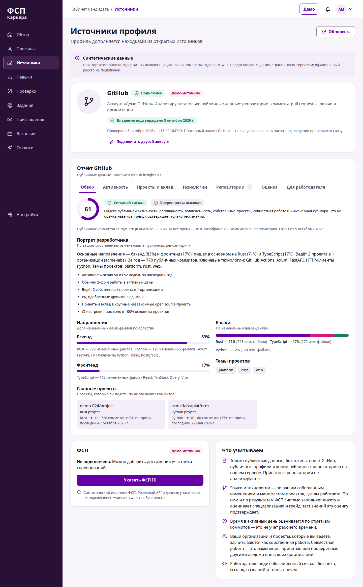

- GitHub connects by login or profile link (repository links are rejected). The card shows the account, ownership
  state with three steps to prove it by the bio code («Проверить код»), the stage and progress of a running
  analysis, errors and «Подключить другой аккаунт»; a mistyped login is rejected at once. The report follows in tabs
  kept in the URL (`?tab=`): «Обзор» (index, coverage, flags, the developer portrait with highlights, areas with
  evidence, languages by changed files, topics, main projects), «Активность» (counts, commit heatmap with a monthly
  table, yearly commits, the estimated rhythm in the author's time zone), «Проекты и вклад» (own projects,
  organizations, collaboration, notable independent projects), «Технологии» (stack by category, catalog evidence,
  engineering practices), «Репозитории» (ten per page with stack and practices) and «Оценка» (dimensions with exact
  metrics). «Как вас видит работодатель» shows the anonymous projection with collapsible metrics. The development
  mock returns the labelled fictional report of a synthetic account.
- FSP accepts a fictional participant ID, offers refresh and ID replacement, and displays event dates, discipline,
  team/individual scope, publication status, place, points and protocol reference. Pending, disqualified and empty
  histories are distinct. The card labels all data fictional and does not turn team results into individual skills.
- An outage leaves the previous snapshot visible beside the error and preserves its date. Legacy seed records
  without detailed results explicitly request a refresh.
- Connecting requires processing consent. Source evidence never changes the confirmed grade.

### `/candidate/skills` — «Навыки и подтверждения»

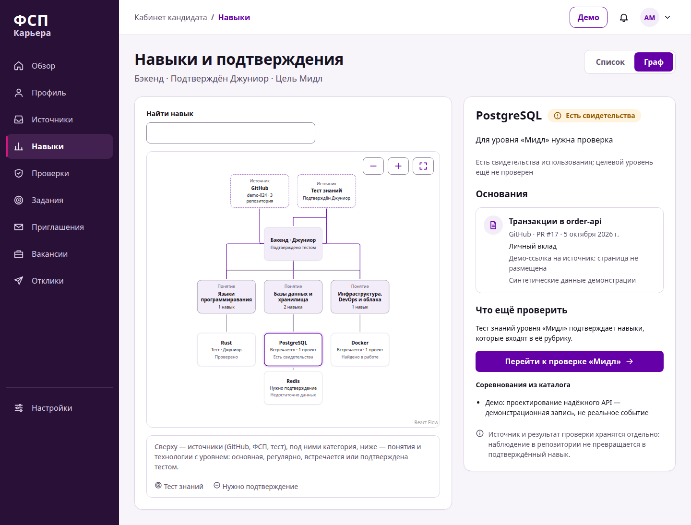

«Список» or «Граф» (kept in the URL), a filter, and an inspector for the selected skill, concept or source. The graph
shows the sources (GitHub, ФСП, «Тест знаний») on top, the category below them, then the concepts, and each concept's
technologies in a column with their level («Основная · 49 проектов», «Тест · Мидл»). The skill inspector shows: state, the level
it was confirmed for and what the target still needs, evidence items with source, date, individual or team scope and
links (demo links as text, assessment evidence links to its result), and «Что ещё проверить» with the check and
catalog competitions. The graph and the list share one selection; the graph has zoom and fit controls and a legend.
Without skills: an empty state with «Подключить GitHub» and «Пройти проверку».

### `/candidate/assessments` — «Проверки»

When `graphInterviews` is enabled, «Интервью по карте навыков» starts or resumes an authenticated interview.
The action opens `/candidate/interviews/{id}`. The session survives reloads, and a completed session can be followed
by a new one.

Below it, «Как устроена проверка» describes versioned knowledge tests, server drafts, scoring thresholds, allowed AI,
failure and service-error rules, the server cooldown, grade restrictions and supported scopes. «Следующий шаг» and
«История попыток» show date, target and variant, status, effect on the category («Джуниор → Мидл», «Грейд сохранён»,
«Без изменений, штрафа и ожидания нет»), «Продолжить» or «Подробнее».

### `/candidate/interviews/{id}` — graph interview

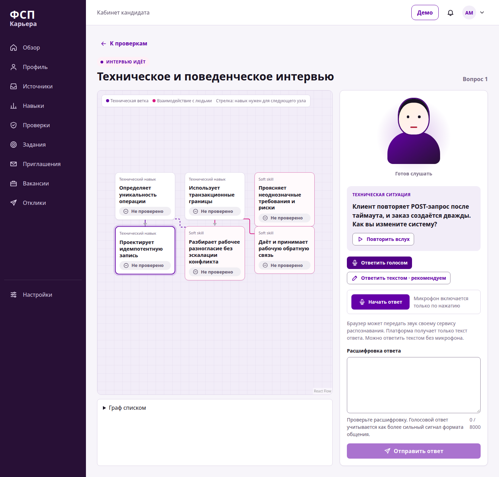

The graph shows prerequisite edges, the current competency and observed/confirmed evidence; «Граф списком» provides
a text alternative. A weak composite answer moves to an unresolved prerequisite. The adjacent dialogue supports
text answers and optional browser speech. Before recording, the interface explains that the browser may send audio
to its recognition service; the platform receives only the confirmed text. Recognition starts on a click and stops
before submission. Failures preserve the draft; late callbacks cannot alter a sent answer or the next question.
Input controls are disabled while an answer is being evaluated. The completed state says «Интервью завершено».
The voice/text format indicator is not proof of identity or a professional grade.

[Mobile example](screenshots/22b-graph-interview-mobile.png). These screenshots use fictional mock data.

### `/candidate/assessments/{id}/workspace` — knowledge test

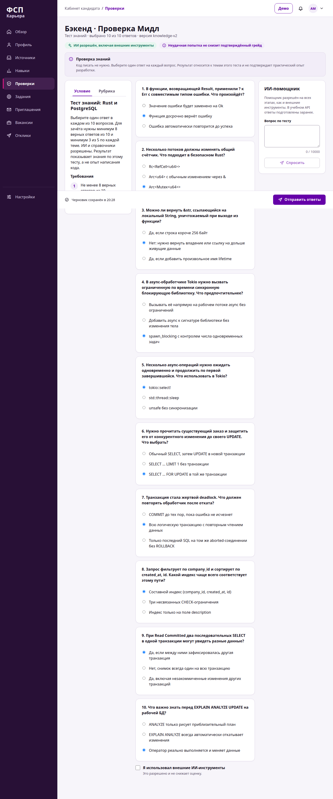

- Version and answered count; explicit knowledge-only scope, allowed AI and preserved grade on failure.
- Task requirements and rubric; ten accessible groups of three radio choices, with one answer per question.
- Contextual AI assistant; Rust calls Bifrost, the development mock labels its prepared answers. Questions remain
  editable after errors. Assistance saves the current responses first and does not decide the grade.
- A queued autosave indicator, retry on failure and «Отправить ответы» with explicit confirmation. Incomplete
  responses cannot be submitted. Inputs lock while submission waits for acknowledged saves and the server result.
- Legacy code attempts are read-only archives. Submitted tests link to their result.

### `/candidate/assessments/{id}/result` — result

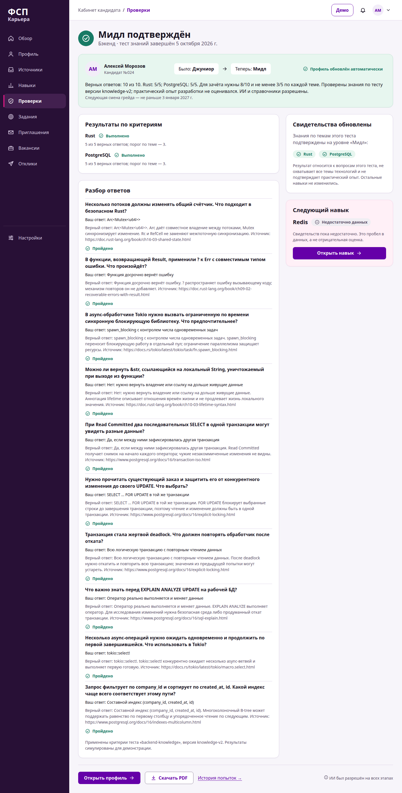
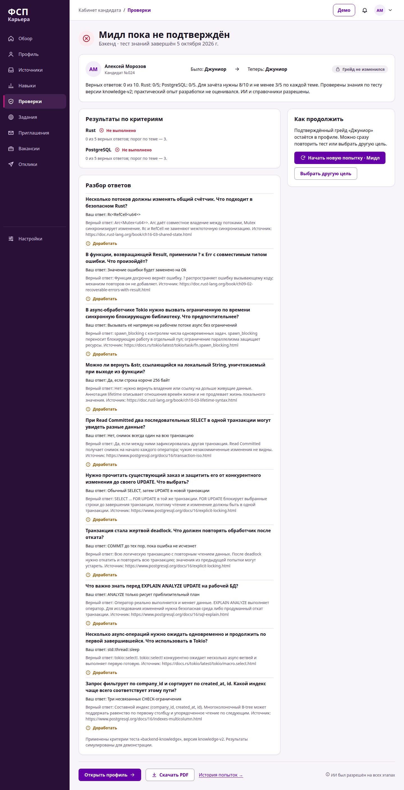

While evaluating: «Решение проверяется», polled until final. Then «Мидл подтверждён» / «… подтверждён повторно» /
«Мидл пока не подтверждён» / «Проверка не пройдена» / «Оценка не получена», with «Было» and «Теперь», «Профиль
обновлён автоматически» after a grade change, feedback, the next possible grade change, rubric results and check
results. The answer review gives selected and correct choices, explanations and primary source references.
The test covers Rust/PostgreSQL knowledge, not practical work. Next steps depend on the outcome: retry, choose another target, open the profile, «Скачать PDF», and the next
skill gap.

### `/candidate/tasks` — «Задания»

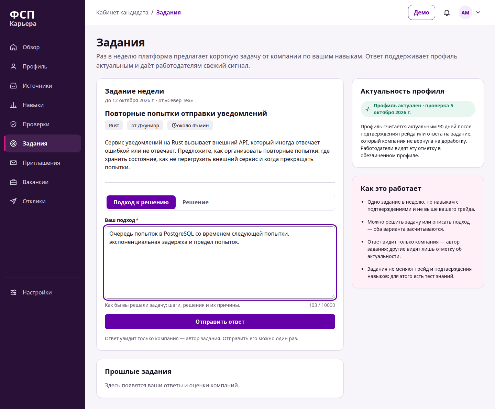

«Задание недели» with the company, title, skill, minimum grade, time estimate, the end of the week and the prompt.
The answer form switches between «Подход к решению» and «Решение» and sends once; afterwards the card shows the
answer, «Ждёт оценки компании», «Засчитано» or «Нужно доработать» and the company's comment. Without a verified grade,
processing consent or a matching task the card says why, links to the fix and names the date of the next offer.
«Прошлые задания» lists earlier answers with their verdicts; «Актуальность профиля» shows «Профиль актуален» or
«Давно не обновлялся» with the last signal and explains the 90-day rule.

### `/candidate/invitations` — «Приглашения»

Tabs «Все», «Ждут решения», «Принятые», «Отклонённые и отозванные» (kept in the URL), each invitation with company,
need, salary with tax basis, work mode, date, status and «Новое». Refreshed when the window regains focus.

### `/candidate/invitations/{id}` — invitation

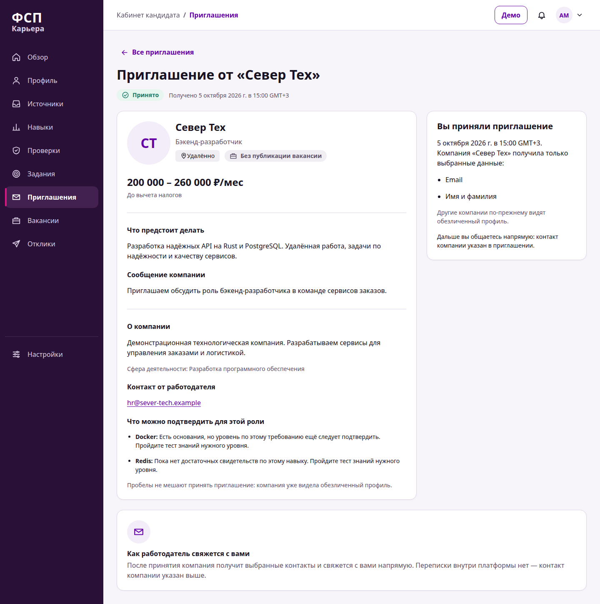

Opening it marks it viewed. Shows the company, need, work mode, «Без публикации вакансии», salary, description,
message, company description, business area and the company's contact, and «Что можно подтвердить для этой роли»
(the gap plan). The decision card selects what to disclose (name and e-mail preselected, source links separately, at
least one required), «Принять и открыть контакты» and «Отклонить» (with confirmation). Accepted, declined and
withdrawn invitations show the outcome and, for acceptance, exactly which fields the company received. A conflict
from another tab shows «Статус уже изменился» and the current state.

### `/candidate/vacancies` — «Вакансии»

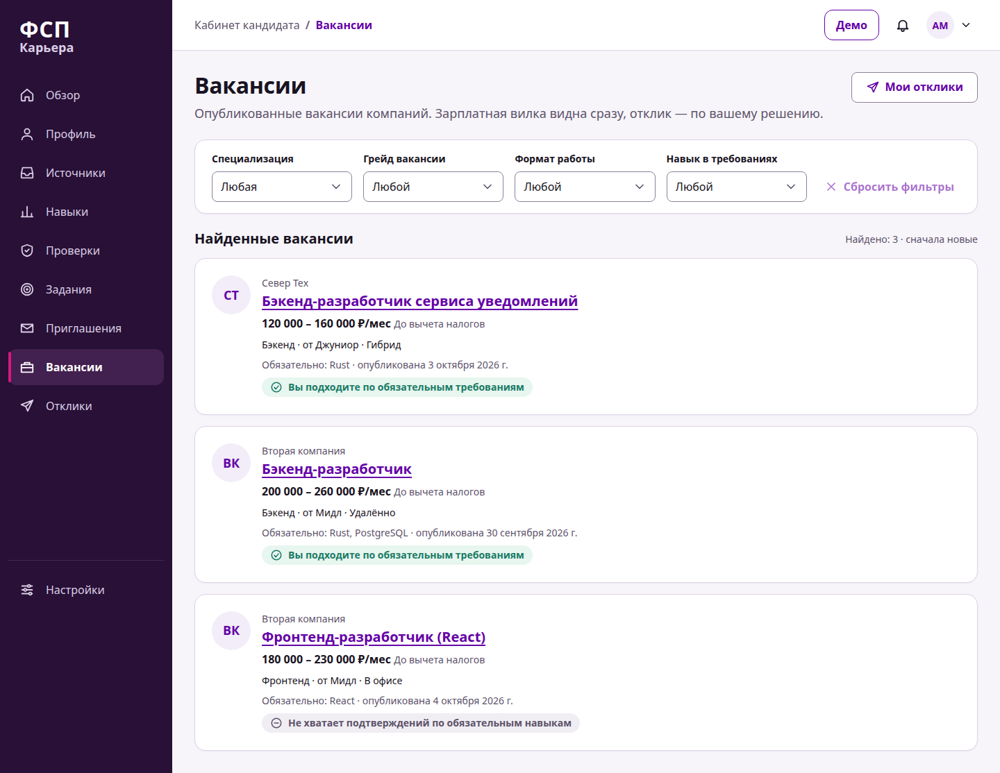

Published vacancies of all companies, best fit first (then newest publication), with filters for specialization, grade, work mode and required
skill (kept in the URL) and paging. Each card shows the company, title, salary with tax basis, specialization, grade,
work mode, required skills, the publication date, the candidate's fit computed by the server («Вы подходите по
обязательным требованиям», «Часть требований стоит подтвердить», «Не хватает подтверждений…») and «Вы откликнулись».
While applying is not yet possible, a note names the reason and links to the fix (questionnaire, assessments,
settings). «Мои отклики» leads to the applications.

### `/candidate/vacancies/{id}` — vacancy

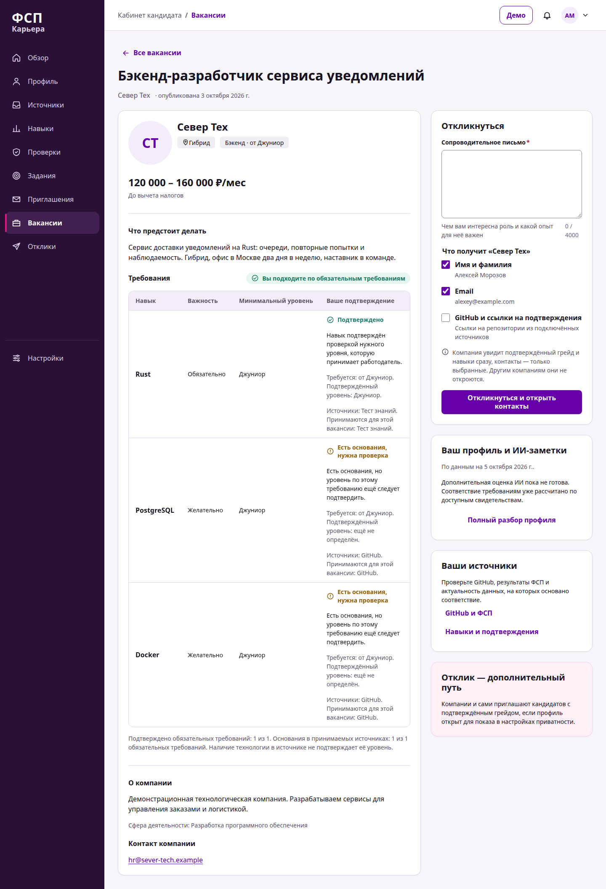

The company, work mode, specialization and grade, salary, description, requirements with importance, minimum level
and the candidate's confirmation per skill, the server's explanation, the company description and contact. The
application card asks for a cover letter (1–4000 characters) and what the company receives (name and e-mail
preselected, source links separately, at least one), then «Откликнуться и открыть контакты» opens the application.
Without a verified grade, questionnaire or processing consent the card says why and links to the fix; after applying
it shows «Вы откликнулись» with the status link. A vacancy taken down meanwhile says so instead of sending.
The sidebar shows the candidate's own AI notes with expandable recommendations, and links to the full profile,
GitHub/FSP sources and skill evidence. Profile notes and vacancy fit refresh every 30 seconds in the foreground.

### `/candidate/applications` — «Отклики»

Tabs «Все», «На рассмотрении», «Приняты», «Отказы и отозванные» (kept in the URL), each application with company,
vacancy, salary, work mode, date and status.

### `/candidate/applications/{id}` — application

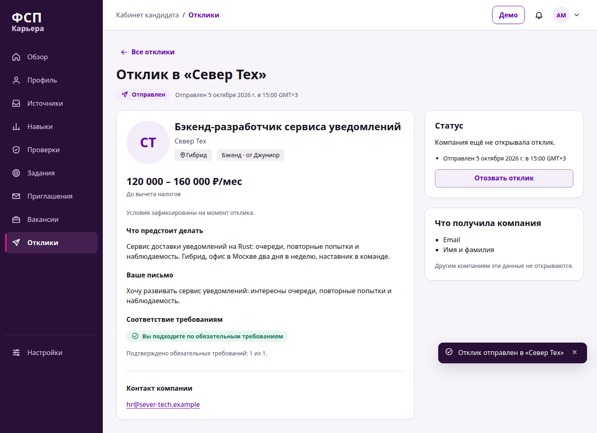

Status («Отправлен», «Просмотрен компанией», «Компания готова к разговору», «Компания отказала», «Отозван вами»)
with its meaning and timeline, the vacancy terms frozen at the moment of applying, the cover letter, the fit, the
company's contact and exactly which fields the company received. «Отозвать отклик» (with confirmation) is offered
while the company has not decided.

### `/candidate/settings` — «Настройки»

Privacy (both consents, how disclosure works, current visibility), sources with their state (disconnecting is not
supported), account e-mail and role, «Выйти».

## Employer

Navigation: Потребности, Кандидаты, Подборки, Приглашения, Отклики, Задания, Компания, Настройки.

### `/employer/needs` — «Потребности»

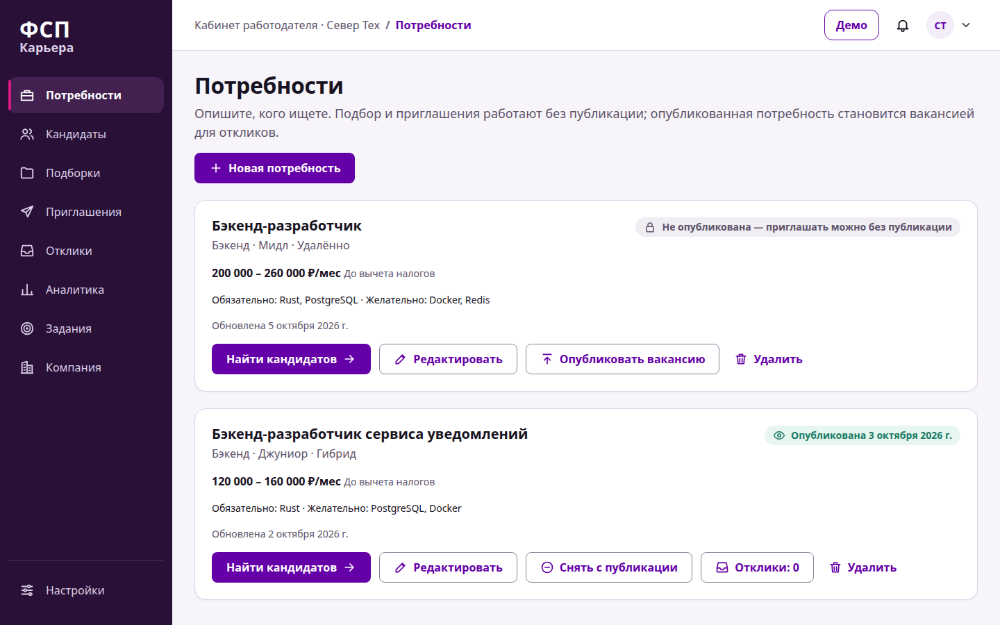

Needs with specialization, grade, work mode, publication state («Опубликована» with the date or «Не опубликована —
приглашать можно без публикации»), salary with tax basis, required and desired skills and the update date; «Найти
кандидатов» (recommended search for the need), «Редактировать», «Опубликовать вакансию» or «Снять с публикации» (with
confirmation; an incomplete company profile gets a link to it), «Отклики: N» for published needs or needs with
applications, «Удалить» (with confirmation; sent invitations and received applications keep their terms) and «Новая
потребность». A new company sees an empty state with «Описать потребность».

### `/employer/needs/new`, `/employer/needs/{id}` — need editor

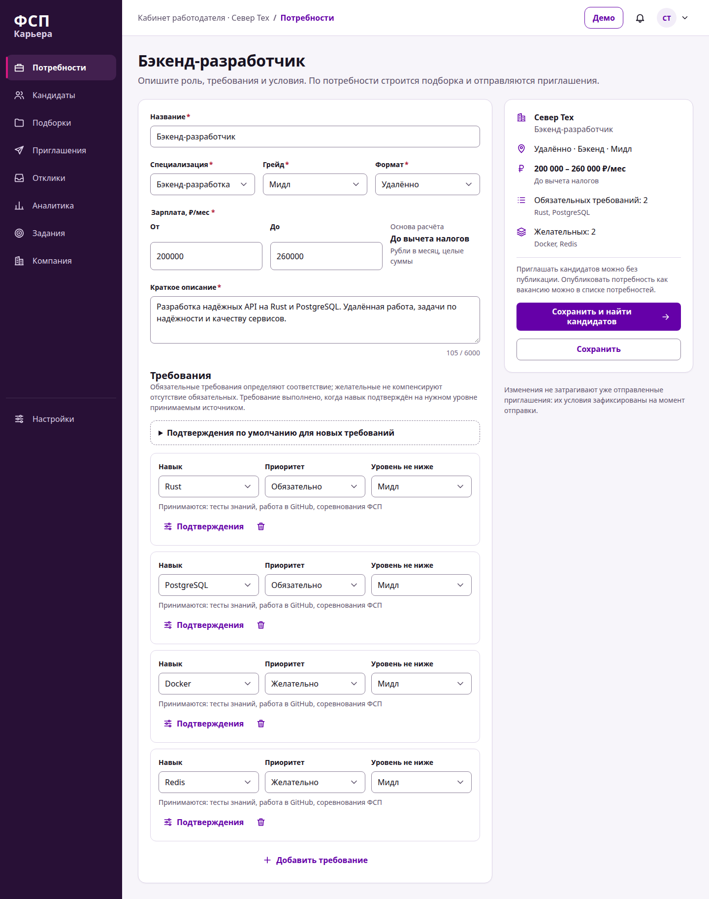

Title, specialization, grade, work mode, salary «от» and «до» in whole rubles per month with the read-only basis «До
вычета налогов», description; requirements with skill, «Обязательно»/«Желательно», minimum level and accepted
evidence (knowledge tests, GitHub work, FSP competitions — any from the catalog or selected ones), a default policy
that can be applied to all rows, add and remove rows; a live summary. «Сохранить и найти кандидатов» opens
recommended search for the need, «Сохранить» stays. A note says invitations need no publication, or, for a published
need, that candidates see edits at once while received applications keep their terms; an incomplete company profile
gets a warning with a link, since invitations need it.

### `/employer/candidates` — «Кандидаты»

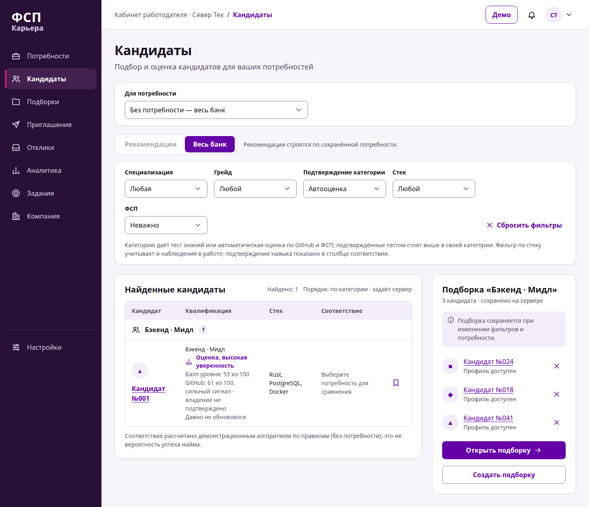
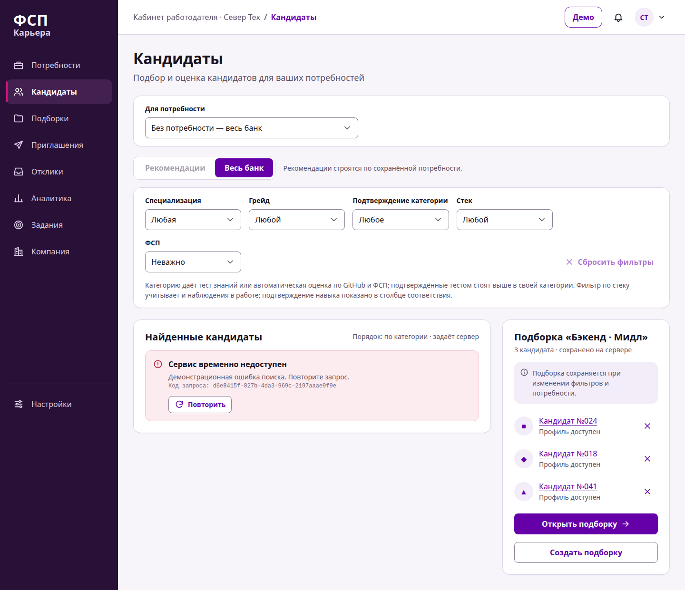

- «Для потребности» selector and mode «Рекомендации» / «Весь банк»; filters for specialization, grade, «Подтверждение
  категории» («Тест знаний» / «Автооценка»), stack and FSP. Everything is in the URL.
- Results grouped by match status («Подходят по обязательным требованиям», «Требуют дополнительной проверки», «Не
  хватает свидетельств по обязательным требованиям»), each row with alias, the category with «Подтверждено тестом» or
  «Оценка, … уверенность» and the score of an estimate, FSP
  participation, freshness, stack, required coverage, the first missing requirement with its reason, desired gaps, and a bookmark
  for the active shortlist. The order is set by the server and the page says it is not a probability of hiring.
- Paging; empty results offer «Сбросить фильтры» or «Весь банк»; a search failure is an error state with retry,
  never stale or fixture results.
- Shortlist panel: choose or create a shortlist; members with availability; removal.

### `/employer/candidates/{id}` — anonymous candidate profile

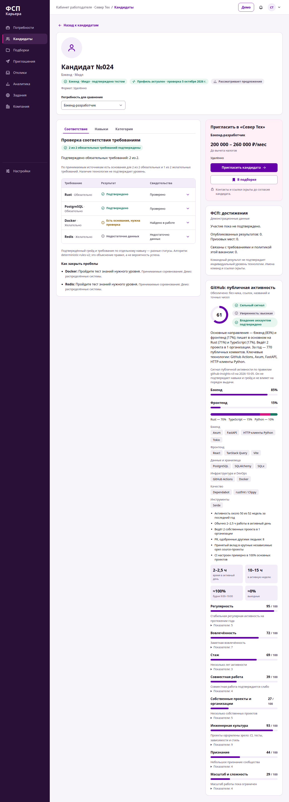
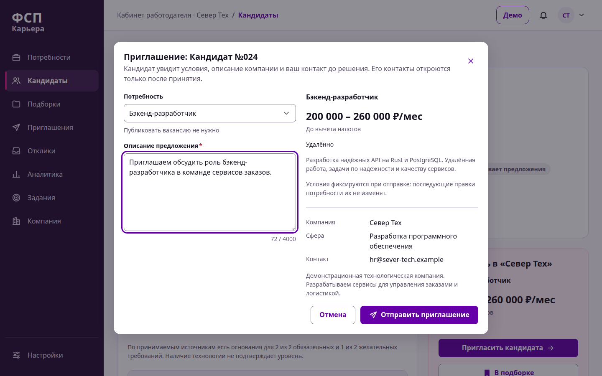
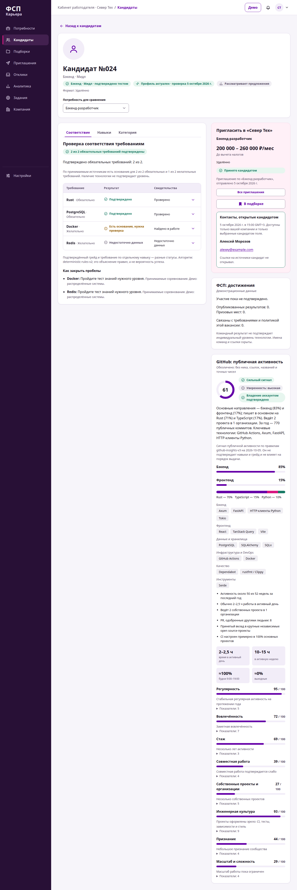

Alias, the category badge with its source, profile freshness, work modes, FSP participation; «Потребность для сравнения»;
the «GitHub: публичная активность» card with the anonymous rounded signal and the ownership state when the candidate connected GitHub (the candidate list shows its index, band and ownership state in the qualification column);
tabs «Соответствие» (per requirement: result, evidence state, reason, gap plan), «Навыки» (list or graph without
evidence details) and «Категория» (the test and its date, or for an estimate the score with each factor's points and
the grade bands). The contacts card says «Контакты и ссылки скрыты до согласия кандидата» until the
candidate accepts this company's invitation, then shows only the fields they chose. «Пригласить кандидата» opens the
composer: need, offer text, the frozen terms and the company contact the candidate will see; blocked with a link
while the company profile is incomplete; an existing active invitation for the need is reported.

### `/employer/shortlists`, `/employer/shortlists/{id}` — «Подборки»

The list with member counts and update dates, «Создать подборку»; a shortlist page with members (unavailable ones
marked «Профиль недоступен: скрыт или вышел из банка»), removal, rename and delete (the candidates stay in the bank).

### `/employer/invitations` — «Приглашения»

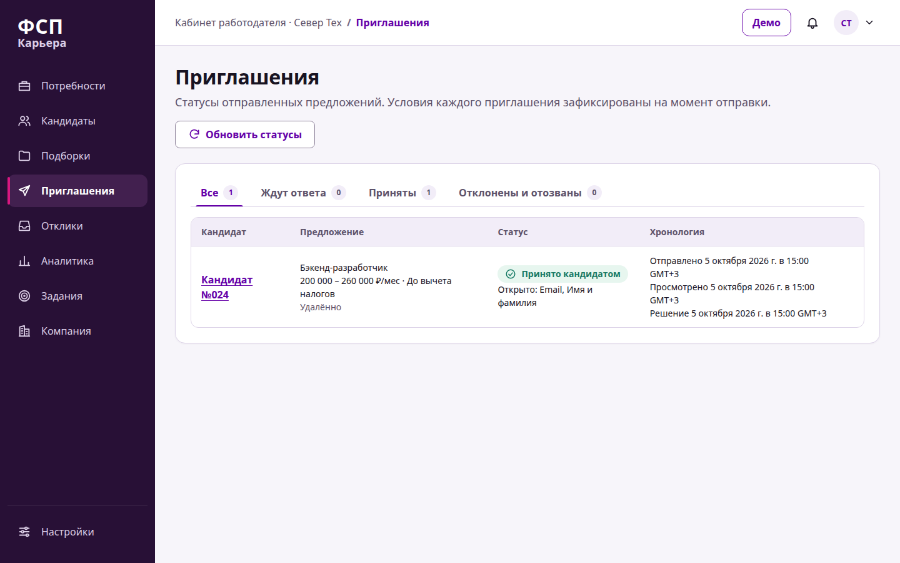

Status tabs (kept in the URL), each invitation with candidate alias, offer and salary, status and a timeline (sent,
viewed, decided), «Отозвать» for open ones (with confirmation; a conflict says the candidate already decided).

### `/employer/applications` — «Отклики»

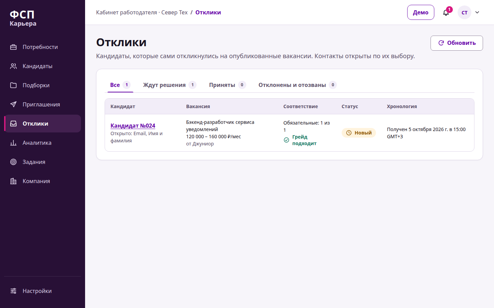

Applications to the company's vacancies with status tabs and, when there are several vacancies, a vacancy filter
(both kept in the URL; «Отклики: N» on a need opens it filtered). Each row shows the candidate alias with the opened
fields, the vacancy with salary and grade, required skills met and whether the grade fits, the status and a timeline.

### `/employer/applications/{id}` — application

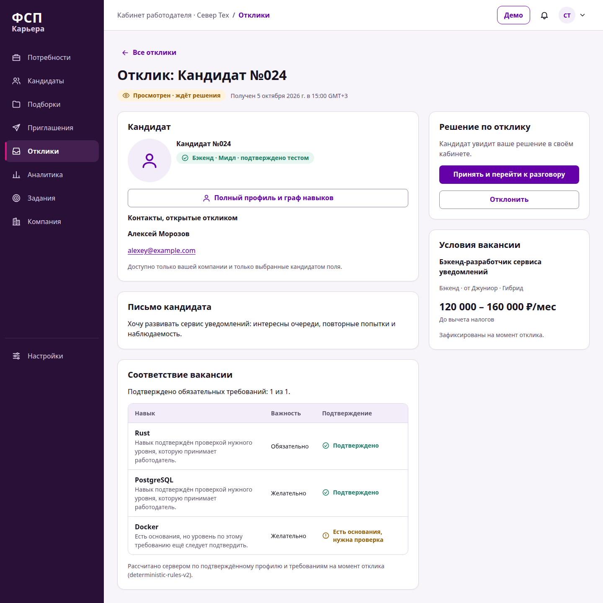

Opening a new application marks it viewed. Shows the anonymous candidate (alias, verified specialization and grade,
verified FSP), a link to the full profile and graph, the contacts the candidate opened, the cover letter, the match
against the vacancy terms frozen at the moment of applying with a reason per requirement, and the terms. The decision
card offers «Принять и перейти к разговору» and «Отклонить» (with confirmation); decided and withdrawn applications
show the outcome, and a withdrawal closes the contacts.

### `/employer/tasks` — «Задания»

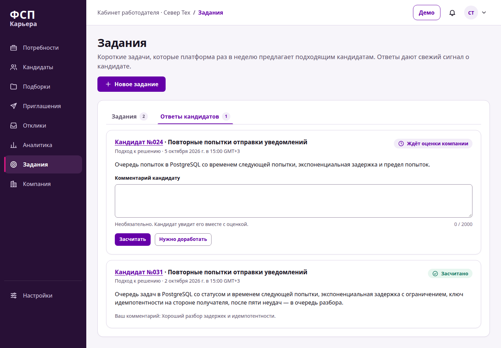

Tabs «Задания» and «Ответы кандидатов» (kept in the URL as `tab`). Tasks show the title, skill, minimum grade,
estimate, date, «Предлагается кандидатам» or «В архиве», the prompt, the answer count and «В архив» (with
confirmation). «Новое задание» opens a dialog with title, prompt, skill, minimum grade and minutes, validated before
sending; an incomplete company profile gets a link to it. Answers show the candidate alias (linking to the anonymous
profile), task, format, time, the answer and its verdict; open answers take an optional comment with «Засчитать» or
«Нужно доработать».

### `/employer/company` — «Профиль компании»

Name, business area, description, contact e-mail for candidates, optional website, «Сохранить»; a warning while the
profile is incomplete and «Как видит кандидат» with «Готово к приглашениям». There is no company verification.

### `/employer/settings` — «Настройки»

Account (company, role, whether the e-mail is verified), link to the company profile, «Выйти», and how access to
candidate data works.

## Shared states

Every data view has loading, empty and error states; errors show a human message, the request ID when present and
a retry. «Раздел недоступен» appears when a signed-in user opens the other role's section, «Страница не найдена» for
unknown paths.

Card headers wrap their heading and actions onto separate lines when space is limited, including the candidate
search count and ordering summary at mobile widths. Live browser verification and updated screenshots are tracked
in [issue #23](https://github.com/KirpaDmitriy/sport-programming-federation/issues/23). The screenshot set above remains
the documented mock fixture gallery, rather than evidence of live backend behavior.

Graph views request generation only when selected. Pending generation shows a loading state; failures show
the server error and an explicit retry, with the list still selectable. Automatic retries are disabled for
these potentially 45-second operations. [Issue #27](https://github.com/KirpaDmitriy/sport-programming-federation/issues/27)
records the related browser finding and final delivery proof.

Matching views also show the server's per-skill minimum and available grade, source provenance and sources accepted
by the selected vacancy. Candidate vacancy pages link to their GitHub/FSP sources and show their own estimate/AI
notes. Employer candidate pages show only aggregated FSP achievements and typed AI second-opinion classifications;
private free-text advice and identifying source information never enter that projection.
